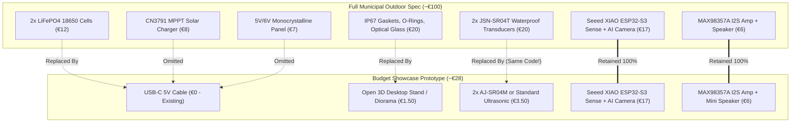

# Daneben! — Low-Cost Showcase & Display Prototype Template

> **Academic Context:** HSNR Studium · 5. Semester · Mikro-controller  
> **Master Design Status:** Unchanged (Permanent IP67, LiFePO4, Solar MPPT municipal architecture remains master standard)  
> **Linked Chats:** [Primary Design Session](conversation://793ac40f-0ce7-467c-98f3-dcd30f32e172) & Current Session (`acbbfc46-4396-4515-bb9d-f0dbe357848c`)  
> **Repository Document:** [`hardware/Budget_Showcase_Prototype_Template.md`](file:///c:/Users/ekwug/OneDrive/Documents/Deutschland/HSNR/Studium/5.Semester/Mikro-contoller/Daneben%20Projekt/hardware/Budget_Showcase_Prototype_Template.md)

---

## 1. Executive Summary

Building an outdoor-ready prototype with custom IP67 gaskets, LiFePO4 battery management, solar cells, and industrial optical glass costs **~€95–€105** retail in Germany. 

For an **indoor presentation, grading evaluation, or exhibition booth**, all heavy outdoor-hardening elements can be cut. By retaining the exact microcomputing, sensing logic, audio output, and Edge AI pipeline while powering via USB-C and utilizing desktop-grade ultrasonic sensors, you achieve **100% interactive functional demonstration for only ~€28 retail** (>70% cost reduction).

---

## 2. Where the Budget Savings Come From

---

## 3. Prototype Bill of Materials (Material Specification)

| Component | Technical Specification | Package / Form Factor | Material / Mounting Remarks | Cost (DE) |
| :--- | :--- | :--- | :--- | :---: |
| **Seeed Studio XIAO ESP32-S3 Sense** | ESP32-S3 Dual-Core, 8MB PSRAM + OV2640 | Dual 1&times;7 Pin Socket (2.54 mm) | Pluggable daughterboard | ~€15.90 |
| **2× AJ-SR04M Transceiver Boards** | 25 kHz Waterproof Ultrasonic (5V) | 1&times;4 Pin Socket + 4&times; M2.5 holes | 41.5 &times; 28.5 mm PCB, external probe | ~€9.00 |
| **MAX98357A I2S Mono DAC/Amp** | 3.2W Class-D Audio Amplifier | 1&times;7 Pin Socket + 2&times; M2.5 holes | 19.0 &times; 18.0 mm PCB | ~€4.49 |
| **Miniature Loudspeaker** | 8 Ω, 0.5W–3W, &oslash; 28–40 mm | Leaded wires to 5.08 mm terminal | Mylar cone / Dynamic driver | ~€1.90 |
| **Modular Carrier Board v2.0** | 130.0 &times; 90.0 mm, 2-Layer FR4 | Custom PCB (1.6 mm thickness) | 1 oz Cu, HASL/ENIG, lead-free | ~€3.00 |
| **Onboard Passives & Connectors** | USB-C 16P, 12x12mm buttons, LEDs, R, C | SMT & THT | Detailed in [`BOM_Carrier_Board_v2.md`](file:///c:/Users/ekwug/OneDrive/Documents/Deutschland/HSNR/Studium/5.Semester/Mikro-contoller/Daneben%20Projekt/hardware/Daneben_Prototype_Carrier_Board/BOM_Carrier_Board_v2.md) | ~€4.50 |
| **Hardware & Standoffs** | 10&times; M2.5 &times; 8mm, 4&times; M3 &times; 12mm | Nylon or Brass | Standoffs, screws, and nuts | ~€3.00 |
| **Total Prototype BOM** | **Complete hardware kit** | | | **~€41.79** |

---

## 4. Tabletop Showcase "Diorama" Concept

Rather than bringing a full-sized 120-liter municipal bin to class:
1. **The Desk Diorama:** Use a desktop pen-holder bin or cardboard container as the "municipal bin".
2. **Mounting:**
   * **Internal Sensor:** Affixed under the rim pointing down into the bin cavity.
   * **External Sensor + Camera:** Mounted facing forward toward a marked tabletop surface ("Gehweg / Pavement Zone").
3. **Live 3-Scenario Demonstration:**
   * **Test 1 (Pedestrian Filter):** Swiping a hand past the sensor clears before the 8-second debounce &rarr; system stays in low power mode (GDPR compliant).
   * **Test 2 (Illegal Placement):** Dropping a miniature cardboard box in the pavement zone triggers the 8-second timer &rarr; camera captures image &rarr; Edge Impulse classifies trash &rarr; internal sensor confirms bin has room &rarr; **device speaks the German warning voice alert** &rarr; live MQTT dashboard logs incident in red.
   * **Test 3 (Bin Overflow):** Filling the mini-bin to the top before placing the box outside suppresses the audio warning (protecting citizen fairness) and emits a `STATUS_BIN_OVERFLOW` fleet dispatch message.

---

## 5. Modular Prototype Carrier Board v2.0 (KiCad 9.0)

To resolve mechanical crowding, eliminate rat's nest wiring, and accommodate different bin heights (from 1m to 4m), the carrier board was redesigned with a generous **130 mm × 90 mm** footprint.

### Interactive 3D Real-Life Visualization
Custom 3D models were created and millimeter-aligned for all components:

### Key Engineering Features & Mechanical Clearances

1. **Dual AJ-SR04M Waterproof Sensor Docking Bays (Zero Cable Friction):**
   - **Outside Dock (`J_AJ_OUT`) & Inside Dock (`J_AJ_IN`):** Each dock provides a 4-pin female socket (`+5V`, `TRIG`, `ECHO`, `GND`) and **4× M2.5 standoff mounting holes**.
   - **Zero Cable Friction:** Both AJ-SR04M modules sit with their metal cylindrical transducer jacks pointing directly toward the outer left edge of the PCB. When the thick shielded probe cables are plugged in, they exit freely into open air without interfering with any headers, chips, or mounting brackets.
   - Modules are mechanically fastened with standoffs so they cannot shift or vibrate.

2. **Dedicated Onboard USB-C Power Entry (`J_USBC`):**
   - Built directly onto the bottom board edge with dual 5.1 kΩ pull-down resistors (`R_CC1`, `R_CC2`) on CC lines for automatic 5V/3A negotiation from any modern USB-C charger or PD power bank.
   - SPDT slide switch (`SW_PWR`) for master board on/off control.
   - Diagnostic green power LED (`LED_PWR`).
   - 100 µF bulk reservoir capacitor (`C_BULK1`) to handle audio amplifier current surges without MCU brownouts.
   - Alternate 2-pin screw terminal (`J_EXT_5V`) for benchtop lab power supplies.

3. **Sizable Dual Calibration Pushbuttons (12mm × 12mm) & Status LEDs:**
   - **Accessible During Installation:** Positioned directly on the PCB inside the main enclosure. When installing on a new bin, the technician opens the enclosure lid, runs the calibrations using the tactile buttons and LED visual cues, and then screws the lid back on. The outer shell requires zero button holes, preserving permanent IP67 waterproofing.
   - **Outside Calibration (`SW_CAL_OUT` on GPIO5):** Sizable 12x12mm tactile button with dedicated blue status LED (`LED_CAL_OUT` on GPIO43). Measures and averages the baseline distance to the floor/pavement over 15 ultrasonic pings, saving the reference into ESP32 non-volatile storage (NVS).
   - **Inside Calibration (`SW_CAL_IN` on GPIO6):** Sizable 12x12mm tactile button with dedicated amber status LED (`LED_CAL_IN` on GPIO44). One-click calibration for any bin height (100cm, 200cm, or 400cm underground containers). Automatically measures empty bin depth, applies 25° cosine slant compensation, and computes continuous 0–100% capacity scaling.

4. **MAX98357A I2S Class D Audio Amplifier Subsystem (`J_AMP`):**
   - Dual M2.5 mounting standoffs to keep the breakout board mechanically rigid.
   - Dedicated 2-pin 5.08mm screw terminal (`J_SPK`) right on the top-right board edge for speaker wire termination.

5. **Seeed Studio XIAO ESP32-S3 Sense Socket (`J_MCU_L` / `J_MCU_R`):**
   - Dual 1x7 female sockets with clear forward optical clearance for the top-mounted OV2640 camera.

### How to View in KiCad 3D Viewer
1. Open the project in KiCad: [`Daneben_Prototype_Carrier_Board.kicad_pro`](file:///c:/Users/ekwug/OneDrive/Documents/Deutschland/HSNR/Studium/5.Semester/Mikro-contoller/Daneben%20Projekt/hardware/Daneben_Prototype_Carrier_Board/Daneben_Prototype_Carrier_Board.kicad_pro).
2. Open the PCB layout in PCB Editor (`Daneben_Prototype_Carrier_Board.kicad_pcb`).
3. Press **`Alt + 3`** (or go to **View &rarr; 3D Viewer**).
4. Orbit and inspect all modules, standoff screw holes, USB-C port, and cable exit paths in real-time 3D.

### Exported Deliverables
- **Master Schematic PDF:** [`carrier_board_schematic.pdf`](file:///c:/Users/ekwug/OneDrive/Documents/Deutschland/HSNR/Studium/5.Semester/Mikro-contoller/Daneben%20Projekt/hardware/Daneben_Prototype_Carrier_Board/carrier_board_schematic.pdf)
- **Vector Schematic SVG:** [`carrier_board_schematic.svg`](file:///c:/Users/ekwug/OneDrive/Documents/Deutschland/HSNR/Studium/5.Semester/Mikro-contoller/Daneben%20Projekt/hardware/Daneben_Prototype_Carrier_Board/carrier_board_schematic.svg)
- **PCB Fabrication Layout PDF:** [`carrier_board_pcb_layout.pdf`](file:///c:/Users/ekwug/OneDrive/Documents/Deutschland/HSNR/Studium/5.Semester/Mikro-contoller/Daneben%20Projekt/hardware/Daneben_Prototype_Carrier_Board/carrier_board_pcb_layout.pdf)
- **High-Res 3D Isometric Render:** [`carrier_board_3d_isometric.png`](file:///c:/Users/ekwug/OneDrive/Documents/Deutschland/HSNR/Studium/5.Semester/Mikro-contoller/Daneben%20Projekt/hardware/Daneben_Prototype_Carrier_Board/carrier_board_3d_isometric.png)
- **High-Res 3D Top-Down Render:** [`carrier_board_3d_top.png`](file:///c:/Users/ekwug/OneDrive/Documents/Deutschland/HSNR/Studium/5.Semester/Mikro-contoller/Daneben%20Projekt/hardware/Daneben_Prototype_Carrier_Board/carrier_board_3d_top.png)
- **Calibration Engine Header:** [`src/calibration.h`](file:///c:/Users/ekwug/OneDrive/Documents/Deutschland/HSNR/Studium/5.Semester/Mikro-contoller/Daneben%20Projekt/src/calibration.h)
